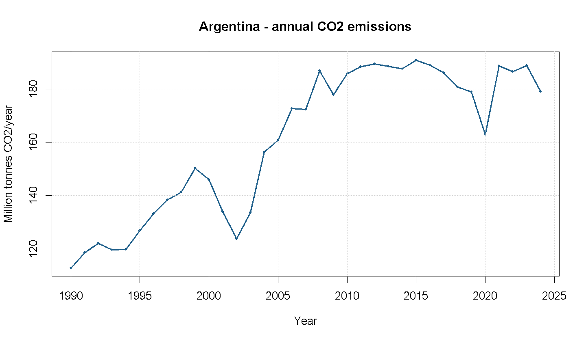
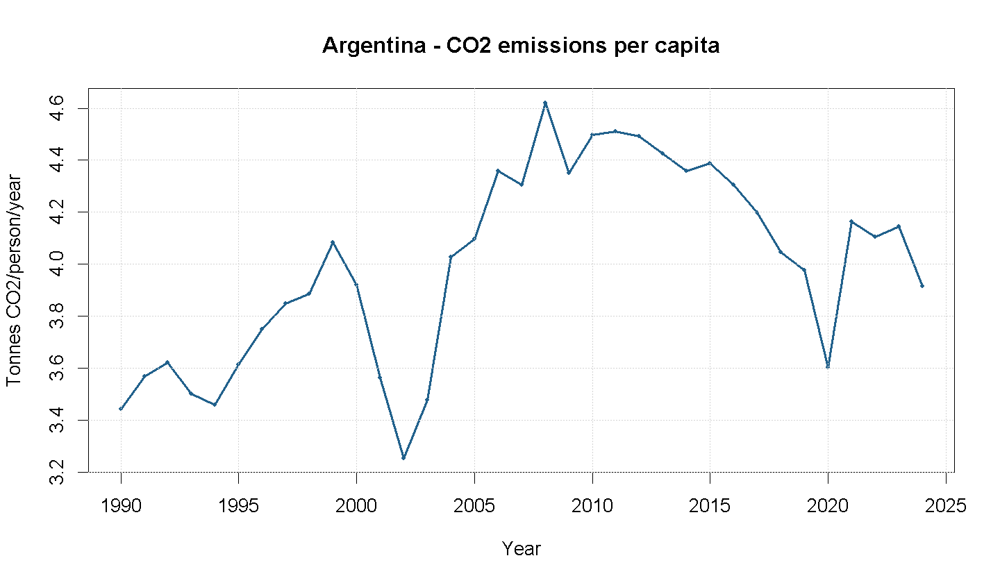
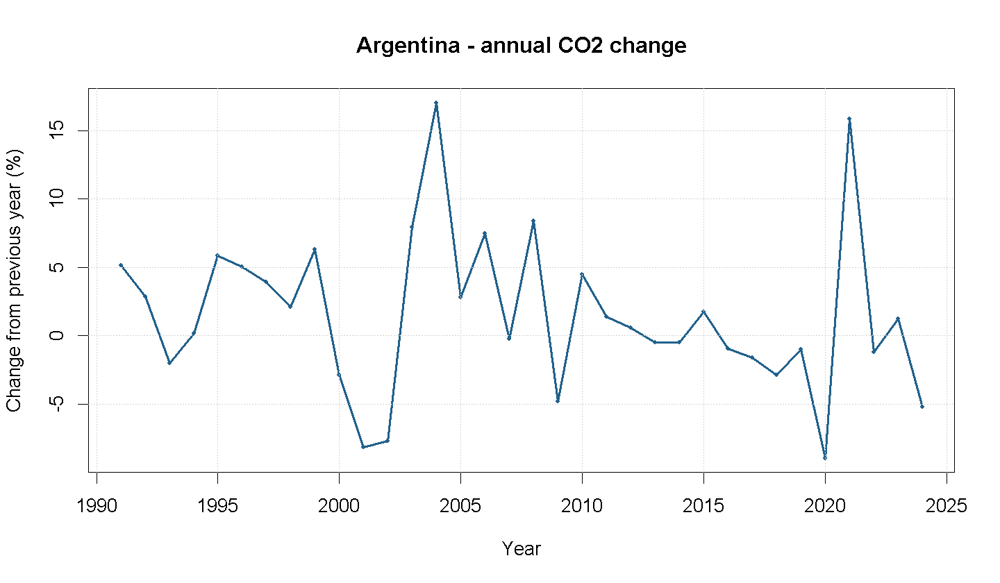

# Argentina CO2 Emissions Analysis (1990–2024)

**Student:** Devine B. Alantay
**Country / ISO-3:** Argentina / ARG
**Study period:** 1990–2024

## Research question

How have Argentina's annual CO2 emissions and per-capita emissions changed from 1990 to 2024?

## Data source and definitions

Source: Our World in Data CO2 and Greenhouse Gas Emissions dataset.
Dataset: https://github.com/owid/co2-data
Direct CSV: https://owid-public.owid.io/data/co2/owid-co2-data.csv
Downloaded on: 14 November 2026.
Selected variables: country, iso_code, year, co2, and co2_per_capita.
The co2 variable is measured in million tonnes per year. The co2_per_capita variable is measured in tonnes per person per year.

## Software and reproducibility

Required software: R, RStudio, Git, and an internet connection for the initial data download.
Open this repository as an RStudio Project. Run the following command in the RStudio Console:

```r
source("scripts/analyze_co2.R")
```

The script uses base R and creates the country-only dataset, figures, and results.

## Results

- Earliest valid year: 1990 (112.79 million tonnes).
- Latest valid year: 2024 (178.96 million tonnes).
- Endpoint change: +58.68%.
- Peak emissions: 2015 (190.77 million tonnes).
- Latest per-capita emissions: 3.92 tonnes per person in 2024.

## Figures







## Interpretation

Argentina's annual territorial CO2 emissions increased from 112.79 million tonnes in 1990 to 178.96 million tonnes in 2024, a 58.68% rise. Emissions peaked in 2015 at 190.77 million tonnes. This indicates a long-term increase in the country's total annual contribution from the fossil-fuel and industrial sources covered by the dataset, although the path was not steady. Per-capita emissions tell a different story: they rose from 3.44 tonnes per person in 1990 to 4.39 in 2015, then fell to 3.92 in 2024. Total emissions measure the country's overall annual amount, while the per-capita measure divides emissions by population and provides a population-adjusted perspective. Neither measure alone describes every environmental impact.

A notable short-term change occurred in 2020, when annual emissions fell by 8.95% to 162.88 million tonnes, followed by a 15.84% increase to 188.67 million tonnes in 2021. The Economic Commission for Latin America and the Caribbean reported that Argentina's economy contracted by 9.9% in 2020 amid the COVID-19 pandemic and began recovering in the first half of 2021 as movement restrictions were eased. This economic context may help explain the timing of the emissions decline and rebound, but the emissions series alone cannot establish that the pandemic or recovery caused those changes.

These patterns matter because fossil-fuel and industrial CO2 emissions contribute to global climate change, which affects ecosystems, species, and environmental conditions across borders. A key limitation is that territorial CO2 accounting records emissions produced within Argentina and excludes land-use change; it does not capture all consumption-related emissions or all greenhouse gases. Country-level totals also conceal differences among regions, industries, and communities.

## Project outputs

- `scripts/analyze_co2.R`: reproducible analysis script.
- `data/ARG_co2.csv`: filtered Argentina dataset.
- `figures/`: three generated figures.
- `results/ARG_summary.csv`: summary statistics.
- `results/ARG_yearly_changes.csv`: annual values and percentage changes.
- `results/session_info.txt`: data source, processing timestamp, and R session information.

## Limitations

The dataset covers territorial fossil-fuel and industrial CO2 emissions and excludes land-use change. Missing observations are not treated as zero. National totals can hide regional and sectoral differences and do not represent all greenhouse gases or consumption-based emissions.

## References

- Our World in Data. CO2 and Greenhouse Gas Emissions. https://github.com/owid/co2-data
- Economic Commission for Latin America and the Caribbean (ECLAC). Economic Survey of Latin America and the Caribbean, 2021: Argentina. https://repositorio.cepal.org/bitstream/handle/11362/47193/42/EI2021_Argentina_en.pdf
